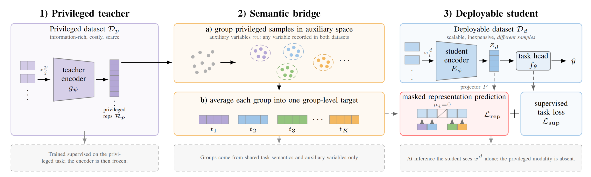

# Privileged Representation Distillation (PRD)

Transferring task-relevant representations from an information-rich but scarce
**privileged** modality to a cheap, scalable **deployable** modality — without
requiring the two to be observed for the same samples.

The running application is COPD. Respiratory audio is the deployable modality;
CT imaging and blood multi-omics are the privileged modalities, and they come
from a different patient population. No subject has both. Inference uses audio
alone.



A teacher learns a representation on the privileged dataset. A semantic bridge
groups privileged subjects using only variables both datasets record and reduces each group to one target vector. The student is
trained with its ordinary supervised loss plus a masked distillatoin onto those
targets; samples whose label has no privileged counterpart are masked out.


## Install

```bash
uv venv --python 3.11
uv pip install -e '.[audio]'
```

Results were produced with Python 3.11, PyTorch 2.13 (CUDA 13.0, cuDNN 9.2),
torchaudio 2.11, scikit-learn 1.9, NumPy 2.4 and pandas 3.0, on NVIDIA H200
GPUs.

## Data

No data is included. See [`data/README.md`](data/README.md) for what to
download and where to put it. The audio corpora are public but must be obtained
from their sources; COPDGene is controlled-access, so the privileged arm cannot
be reproduced without a data-use agreement.

## Run

```bash
cd voice_omics

python preprocessing.py                                        # slice audio, build manifests
python train_teachers.py  --view ct_clinical --seed 42         # privileged teacher
python run_bridge.py      --view ct_clinical --seed 42 --age_tolerance 5
python train_baseline_audio.py --encoder CNN --seed 42         # audio-only baseline
python train_distilled.py --view ct_clinical --encoder CNN --seed 42 \
       --distill_loss smooth_l1 --distill_weight 1.0 --age_tolerance 5
python report.py
```

Full grids are driven by `make_paper_jobs.py`, which prints the outstanding
commands and skips anything already computed:

```bash
python make_paper_jobs.py --phase count
bash scripts/run_factorial.sh         # the main ablation (below)
bash scripts/run_ablation.sh          # wider signal-specificity ladder
```

Every script writes under `$RESULTS_ROOT` (default `results/`), so separate
studies stay in separate trees.

## Main ablation

A 2x2 over the two things the bridge is supposed to supply: a representation
the teacher actually *learned*, and groups formed from the *auxiliary
variables*.

```bash
cd voice_omics
bash scripts/run_factorial.sh
RESULTS_ROOT=results_A10 python factorial_table.py --latex
```

The untrained cells need bridge targets built from a randomly initialised
encoder. `run_factorial.sh` builds them first, or directly:

```bash
python run_bridge.py --view ct_clinical --seed 42 --age_tolerance 5 --random_teacher
```

`--random_teacher` and `--ablation` are independent axes on
`train_distilled.py` and compose, so the fourth cell is
`--ablation class_prototype --random_teacher`.


## Layout

```
voice_omics/          all code; one script per pipeline stage
  config.py             paths, hyperparameters, the two front-end configurations
  preprocessing.py      audio slicing and manifest construction
  train_teachers.py     privileged tabular teachers (CT, omics)
  run_bridge.py         value matching -> group-level distillation targets
  train_baseline_audio.py, train_distilled.py
  train_contrastive.py, train_dtca.py    alternative transfer channels
  report.py, factorial_table.py, ablation_table.py, teacher_table.py
  audit_targets.py, audit_shuffle.py, audit_device_confound.py
  scripts/              end-to-end run scripts
```


